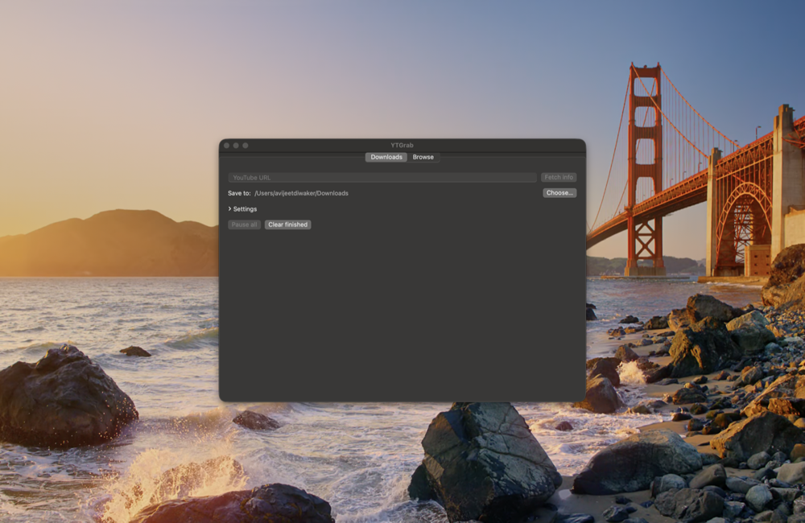
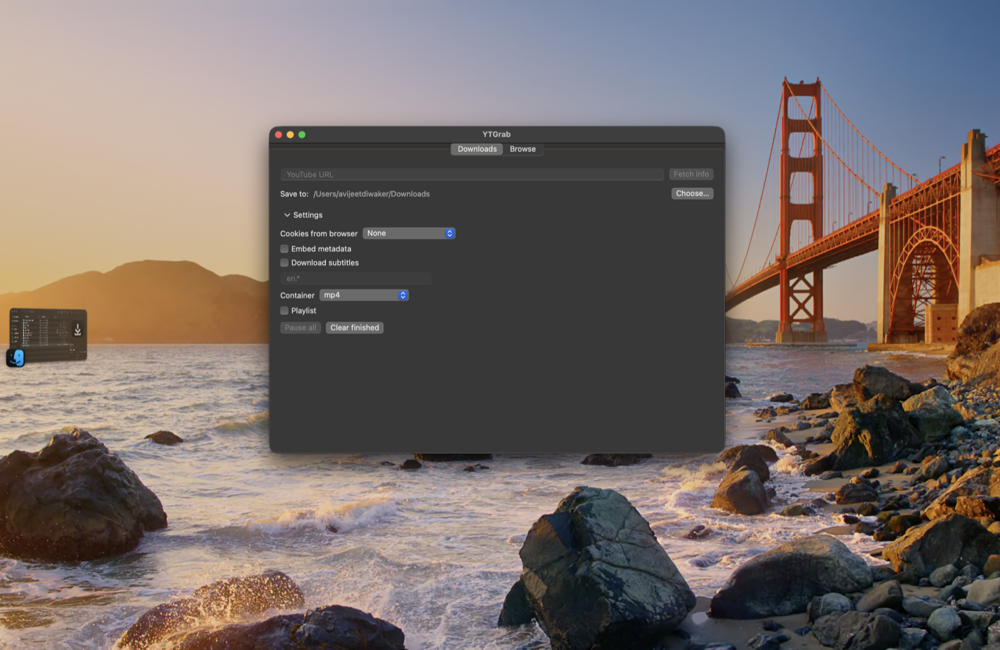

# YTGrab

A small, native macOS front-end for
[yt-dlp](https://github.com/yt-dlp/yt-dlp) — pure SwiftUI, no WebView,
no Electron, no third-party Swift dependencies.

## Legal

**For content you own or are licensed/permitted to download (e.g. personal
use of your own uploads or Creative Commons media).** Downloading videos
may violate YouTube's Terms of Service — check what applies to you before
using this tool. YTGrab ships no YouTube branding, is not affiliated with
YouTube or Google, and yt-dlp is a separate open-source project (see
https://github.com/yt-dlp/yt-dlp) doing the actual downloading.

## Requirements

- macOS 14+
- `brew install yt-dlp ffmpeg` (deno optional but used by yt-dlp for
  YouTube JS challenges)

## Build

```sh
./build.sh            # swift build -c release + assembles YTGrab.app +
                      # ad-hoc codesign with hardened runtime + verify
open YTGrab.app
```

Or: `make build` (release binary), `make test`, `make lint`, `make app`.
Network end-to-end tests: `make e2e` (sets `YTGRAB_E2E=1`).

## Install

```sh
brew install yt-dlp ffmpeg   # prerequisites
make install                 # builds, then copies YTGrab.app to /Applications
```

…or just drag `YTGrab.app` to `/Applications` yourself.

**First launch:** the app is ad-hoc signed, not notarized. A locally built
copy has no quarantine flag and opens directly. If the app was downloaded
or AirDropped, macOS marks it quarantined — right-click → **Open**, or:

```sh
xattr -dr com.apple.quarantine /Applications/YTGrab.app
```

## Screenshots

| | |
|---|---|
| Downloads |  |
| Browse |  |
| Settings |  |

## Features

- Paste a YouTube URL → **Fetch info** → pick quality
  (best / up to the video's real heights / audio-only m4a or mp3)
- Download queue (max 2 concurrent): progress %, speed, ETA, size,
  merge/post-processing phase
- Per job: Pause (SIGSTOP whole process group), Resume, Stop
  (keeps `.part` for later `--continue`), Restart from zero
  (`--no-continue --force-overwrites`), Retry, Reveal in Finder, Remove
- Global: Pause all, Clear finished; children are killed on app quit
- Save folder via NSOpenPanel (default ~/Downloads, persisted)
- Settings: cookies-from-browser, embed metadata, subtitles with
  editable language list, playlist toggle, container (mp4/mkv/webm)
- **Browse tab**: search (`ytsearch30:`) or paste a channel/@handle/
  playlist/video URL → flat-playlist listing with thumbnails, durations,
  views; multi-select + per-row download; Load more paginates
  via `--playlist-items` windows

## Security notes

- Processes are spawned via `posix_spawn` with an explicit argv — never
  a shell, never string concatenation. `--` always precedes user input.
- yt-dlp/ffmpeg are resolved only from `/opt/homebrew/bin` and
  `/usr/local/bin` (`isExecutableFile`); PATH is never searched.
- Child environment is minimal: PATH, HOME, LANG. `--ffmpeg-location`
  is passed explicitly.
- Every yt-dlp run carries `--ignore-config --no-exec --no-plugin-dirs`.
- URLs are validated before spawning: https only, host whitelist
  {youtube.com, www.youtube.com, m.youtube.com, music.youtube.com,
  youtu.be}, no userinfo, ≤2048 chars, no whitespace/control chars;
  channel/playlist paths validated against strict shapes; query keys
  limited to {v, list, t, si, pp, index, feature}.
- Thumbnails are fetched only from `i.ytimg.com` using URLs built from
  regex-validated video ids — never taken from yt-dlp JSON — over an
  ephemeral URLSession (no cookies, no disk cache).
- Search queries are sanitized (≤200 chars, no control chars) and always
  sent as `ytsearchN:<query>` after `--`.
- Children run in their own process groups, so Pause/Stop/Quit signals
  reach the whole tree (including ffmpeg during merges).
- **App Sandbox is intentionally not enabled**: the sandbox would block
  executing binaries from /opt/homebrew. Instead the app is ad-hoc
  signed with the hardened runtime and relies on the constraints above.
  See docs/SOURCES.md for flag provenance and docs/ARCHITECTURE.md for
  the threat model.
